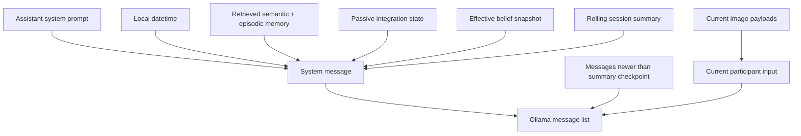

# Context construction

Ollama model calls are stateless. Astra must reconstruct continuity from durable application state for every inference—including the first turn after Ollama restarts. The demo creates a fresh seeded workspace whenever its own server starts.

## Prompt composition



`ContextBuilder` assembles the message list in this order:

1. the assistant system prompt and current local datetime;
2. retrieved memory and passive integration state;
3. the effective belief snapshot;
4. the rolling session summary, when present;
5. bounded recent history;
6. the current participant message and current attachments.

## Summary checkpoint semantics

`SummaryStore` persists the summary text and the last covered message ID.
`ContextBuilder` compares recent eligible conversation rows directly with that
ID. It includes unsummarized messages within `context.history_limit` and keeps
up to two recent messages for continuity even when the summary covers them.

```text
message IDs 101 ─── 104 │ 108 ─── 111 │ current
     covered by summary   unsummarized
```

IDs can skip because they are allocated across sessions. Comparing row IDs
directly preserves the checkpoint boundary when conversations are interleaved.

## Historical images

The demo sends current-turn images to Ollama as binary multimodal payloads. Replaying historical images would increase the request size with every turn.

Historical image turns are represented as text:

```text
[Earlier attached image: workspace.png. Image summary: A terminal showing a failed build.]
```

The original bytes remain available to the history UI. When a historical image has a stored summary, the builder uses it with the filename. The demo uses filename-only context for its own uploads.

!!! success "Stability invariant"
    The cost of a new text-only turn must not grow with the byte size of images attached to previous turns.

## Deduplication

The orchestrator persists the current user turn before building context. The builder therefore detects the stored copy by role, sender, content, and attachment identity, then includes only the authoritative current input with its live media payload.

## Per-request prompt budget

The opt-in `context.prompt_budget` guard runs before generation. It uses the smaller
of the configured context cap and any lower effective backend context setting,
then reserves space for output and framing. Its text and media estimates are
approximate. Compare estimates with reported Ollama prompt counts when tuning
`text_bytes_per_token`.

- Required system policy and current input take priority. When task-local reasoning
  is active, the guard also protects the current workspace and its latest call pair.
- Optional background and history can be reduced. Web evidence can lose navigation
  and older bulk excerpts before recent page windows and find results are shortened.
- MCP compaction drops duplicated structured output before shortening text. It
  preserves status, source identity, and resource links, and marks truncation.
- Ordinary native continuations preserve the latest selected call, its preamble
  and thinking fields, and a matching result. Compact terminal recovery uses a
  separate reduced input described in the [runtime lifecycle](runtime.md#buffered-inference-and-recovery).

Reductions apply to the outgoing request. Stored history and tool observations
retain their existing contents. Required context that exceeds the budget fails
before inference. See [getting started](../getting-started.md#configure-the-demo) for configuration and
[web access](web-access.md#prompt-budgets-and-recovery) for evidence retention.

## Configuration

`context.history_limit` bounds recent messages. `orchestrator.summary_trigger` controls how many new messages may accumulate before `TurnFinalizer` refreshes the rolling summary. Keep the history limit at least as large as the summary interval if every unsummarized message must always be available.

Semantic memories normally pass `context.semantic_memory_max_distance`. If that strict
selection is empty, up to `context.semantic_memory_fallback_limit` nearest candidates
may pass the wider `context.semantic_memory_fallback_max_distance` ceiling. The fallback
never supplements an existing strict match.

Past-conversation vector matches use the separate
`context.episodic_memory_max_distance` ceiling and do not use the semantic fallback.

History summarization uses its own `orchestrator.summary_timeout_s` (300 seconds) and `orchestrator.summary_num_predict` (384 output tokens), with thinking disabled and temperature 0.2. These settings do not change normal chat generation. Each completed turn summarizes at most `summary_trigger` pending messages, preserving the remaining backlog for later turns. Failed requests leave the saved summary and checkpoint unchanged. The batch bounds message count, not token count; unusually long messages can still exceed the timeout.
