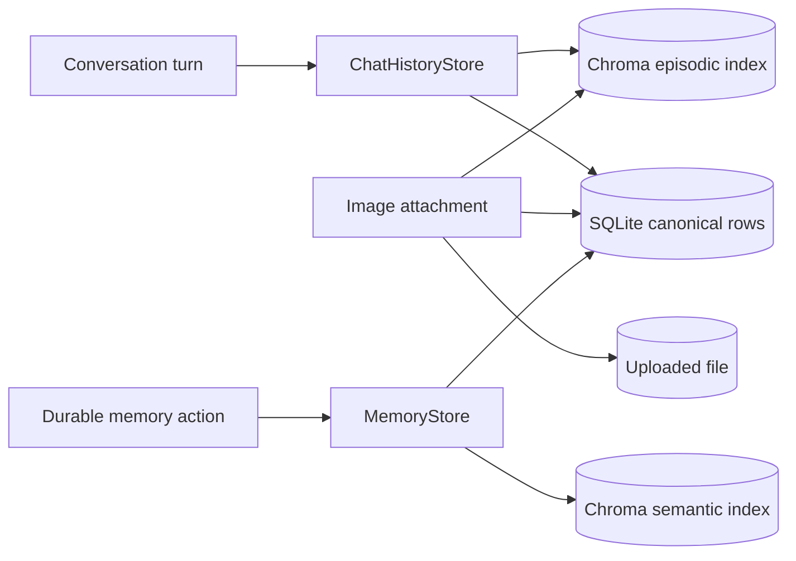

# Memory

Astra uses multiple forms of continuity because a chat transcript, a durable fact, and a revisable current claim have different lifecycles.

## Storage model



### Conversation history

`ChatHistoryStore` persists every message in SQLite, stores image metadata and files, and indexes retrieval-oriented text in the episodic collection. The active generation owns its database, attachment files, and episodic entries. Restoring the workspace rebuilds them from the fixtures.

### Long-term memory

`MemoryStore` holds event, decision, instruction, experience, and narrative information worth recalling later. It writes canonical rows to SQLite and embeddings to the semantic collection.

### Rolling summaries

`SummaryStore` keeps one evolving summary per session with a message-ID checkpoint. `TurnFinalizer` updates it after enough new messages accumulate. Context construction compares message IDs directly against this checkpoint. It reads the newest eligible user and assistant messages, excluding rows marked out of context, within the configured history limit. All newer messages in that window are retained, with up to two recent messages kept for continuity when the summary is current. If the unsummarized backlog exceeds the limit, the newest messages win; older backlog remains stored for subsequent summarization and the reader does not advance the checkpoint. Summaries without a checkpoint conservatively retain the full recent-history window.

## Retrieval during a turn

After the current user message is durably persisted, `MemoryRetriever` searches relevant long-term facts and episodic records from past sessions. Results are bounded and inserted into an explicitly untrusted background-context section of the system prompt.

Retrieval is relevance-based; it is not a replacement for the current session's summary and recent-history window.

## On-demand conversation history

The native tools `history__search` and `history__read` let Astra revisit stored
conversation messages when the recent window or rolling summary is insufficient.
Both tools read stored conversations. Retrieved text and attachment summaries are
marked as untrusted data. Semantic memory and beliefs have their own storage and
mutation paths.

Search locates relevant messages and returns excerpts, not full conversational
context. When a promising match is found, Astra is guided to read its surrounding
conversation before interpreting references, attachments or attribution, or making
additional searches. Reading an existing promising match is preferred over
repeating searches with slightly different queries.

| Native tool | Arguments | Result |
| --- | --- | --- |
| `history__search` | Required `query`: 1–2,000 characters; optional `limit`: 1–8, default 5 | Semantic matches with stable `message:<id>` references, session/message IDs, sender attribution, timestamp, excerpts and attachment summaries. |
| `history__read` | Required `ref`: a `message:<id>` reference; optional `before` and `after`: 0–3 messages each, default 2 | A chronological window containing the anchor and eligible neighboring messages from the same session. |

Search uses the existing Chroma episodic collection and
`context.episodic_memory_max_distance`. It considers at most 64 ranked candidates,
including older messages in the current session, then resolves their IDs against
SQLite. Vector documents and metadata never determine returned content or access.
Attachment candidates resolve to their parent message; duplicate parents, stale
IDs, deleted sessions and excluded messages are skipped. An empty result is a
successful search. A vector outage reports `unavailable`; it does not trigger a
full-text scan or another inference request. Reads need only SQLite.

### Access scope

The demo creates direct conversations under its configured local participant
and assistant. The shared history store enforces the following authority checks.

The runtime requires an accepted, persisted participant turn whose session,
sender, input source, session kind and assistant identity match canonical data.
The native integration capability allowlist still applies. The demo exposes the
tools to its accepted participant turns.

There is no general session-membership ACL or trust flag in current history
metadata. Cross-session retrieval requires a private receiver: the accepted turn
must come from the configured local human using local text or voice in an
explicitly direct session. Every conversational row in that current session must
be attributed to that human or the configured local assistant, with the
corresponding local input/generation source. Excluded rows still participate in
this check; excluding a message cannot make a shared chat private.

From that private receiver, a historical source is accessible through either:

- the existing direct-chat rule: an explicitly direct source with only those same
  local participants and input/generation sources, including at least one
  explicitly attributed local-human message; or
- the trusted conversation archive: its exact session ID is designated in the
  owner-managed `integrations.history.trusted_session_ids` configuration, or the
  owner has enabled `integrations.history.allow_all_sessions`. Its canonical
  session must exist as a direct or manual-group conversation.

The allowlist defaults to empty and `allow_all_sessions` defaults to `false`.
A designation explicitly authorizes the private
owner chat to retrieve eligible messages from the whole source session, including
other speakers' messages and surrounding context. It is a session-level grant,
not a grant for individual excerpts or participants. Neither display names,
derived Relay identities, Astra's participation nor vector metadata establish
archive trust. Unlisted legacy groups stay inaccessible across sessions unless
the owner enables `allow_all_sessions`.
Explicitly trusted legacy records with missing sender fields return `null` for
those fields; on-demand retrieval never guesses that the local human or Astra
authored them. Existing canonical IDs, names, types and input sources are retained
within the output field bounds.

Group/Relay turns and mixed or legacy direct chats are limited to their current
conversation, even if their own session or a desired source is on the allowlist.
An accepted participant turn is treated as authority to read that shared
conversation, consistent with current conversation access; there is no
per-message audience metadata. Designating a source never makes a mixed or group
receiver private.
References are identifiers, not access tokens: read checks authority again, and
search rechecks it after vector lookup. Unauthorized, deleted and stale references
return the same generic error. Only conversational rows preceding the accepted
input message are eligible; the current input and later messages are excluded.
Deletion tombstones and excluded-message flags override explicit archive trust.
Missing canonical session records are inaccessible even if their IDs are listed.

### Output bounds and configuration

Each tool observation is at most 10,000 UTF-8 bytes. Search excerpts have a
400-character limit; read text has a 1,200-character limit per message. At most
three attachments per message are described by filename, MIME type and an existing
summary of at most 300 characters. Storage paths, public upload URLs, hashes and
binaries are never loaded into the result. No new attachment summary is generated.
The aggregate cap can shorten text/summaries or remove matches/window endpoints;
reads retain their anchor and chronological order. `returned_count` and `truncated`
describe the actual payload, with truncation flags also present on records and
attachment summaries.

For example, `history__search({"query":"Which architecture did we choose?","limit":1})`
can return:

```json
{
  "kind": "history_search",
  "untrusted": true,
  "matches": [{
    "ref": "message:42", "message_id": 42, "session_id": "earlier-chat",
    "role": "user", "timestamp": "2026-11-01 12:00:00",
    "sender": {"id": "local-human", "display_name": "You", "type": "human", "input_source": "local_text"},
    "text": "We chose the Aurora architecture.", "truncated": false,
    "attachments": [], "distance": 0.18
  }],
  "returned_count": 1,
  "truncated": false
}
```

`history__read({"ref":"message:42","before":0,"after":0})` returns the same
attributed message inside `{"kind":"history_window","untrusted":true,"anchor_ref":"message:42","messages":[...]}`,
without the search distance, plus `returned_count` and `truncated`.

`integrations.history.enabled` defaults to `true`; set it to `false` to remove both
tools. To designate an archive, edit the local configuration, using actual session
IDs (not titles or speaker names):

```yaml
integrations:
  history:
    enabled: true
    allow_all_sessions: false
    trusted_session_ids:
      - shared-project-session-id
```

For a single-owner local archive, set `allow_all_sessions: true` to authorize all
existing and future historical direct/group sessions without listing their IDs.
This expands source access only: the receiver must still be a private local-owner
chat. Group/Relay callers, deleted sessions, excluded messages and missing
canonical session records retain their existing restrictions. The explicit list
can remain configured; it is used when `allow_all_sessions` is disabled again.

At most 256 unique, valid session IDs may be listed; wildcards are rejected. The
policy is an immutable startup snapshot. Restart the demo after editing the list.
After a restart, the demo loads the configured archive policy and creates a fresh
workspace. No trust decisions are inferred or written by the model. No
database migration or trust backfill is needed because stable session IDs and
deletion tombstones already identify canonical conversations.

This policy governs `history__search` and `history__read`. Automatic
`MemoryRetriever` recall remains a separate, unchanged path without these per-turn
archive checks. The allowlist is therefore **not an archive-wide disclosure
guarantee** for all model context; aligning automatic recall with it requires a
separate change. The demo uses the same SQLite store and episodic index for the history tools. Candidate
filtering can yield fewer matches than requested; there is no exhaustive search
guarantee or automatic pagination in this version.

## Memory versus beliefs

Use durable memory for things worth recalling as an event or narrative later. Use [beliefs](beliefs.md) for present, revisable claims about what is true. The same proposition normally should not be written to both systems.
