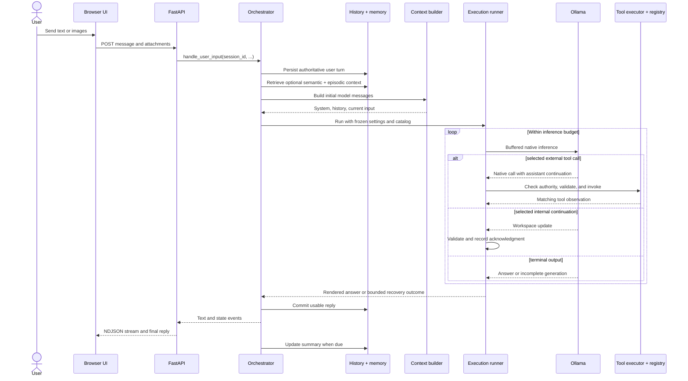
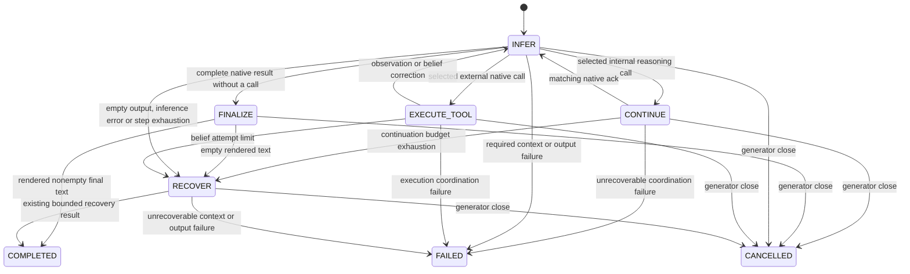

# Runtime lifecycle

A normal turn crosses transport, persistence, retrieval, model inference, optional capabilities, and presentation. The orchestrator coordinates those stages without owning the active session globally.

## User turn sequence

## Authoritative input

The server validates the text and attachments before calling the orchestrator. The orchestrator normalizes the input into a `TurnInput`, assigns trusted sender attribution and persists the user message before exposing turn-scoped tools. A frozen `AuthoritativeTurnContext` then anchors session, message, sender, observation time, input source, and timezone.

This ordering matters: model arguments may express an intended action, but they cannot invent the authority under which that action runs.

## Native tool routing

The normal request uses buffered inference with registered capability schemas.
The runner admits one native tool call per inference step and bounds the number
of steps. Tool observations enter the model conversation before the next step.

## Native execution state machine

Participant turns use the shared `ExecutionRunner`. Its turn-local
`ExecutionState` separates execution phases from model inference modes
(`initial`, `continuation`, `correction`, `recovery`) and from browser status.

`COMPLETED` means generation returned a result, including the existing deterministic
fallback; the orchestrator still decides whether to persist a usable answer or expose
a retryable failed turn. It owns final speech/end emission and completion observers.
The runner never owns history, sockets or model/tool resources.

`ResponseGenerator` retains prompt preparation, native first-call selection and argument
parsing, assistant continuation replay fields, response rendering, and buffered recovery. The runner controls when those callbacks run and
maintains belief attempts, suppressed capabilities, observations and budgets. External
dispatch still uses `ToolExecutor` and the registry's independent authorization checks.

### Buffered inference and recovery

The runner consumes one `BufferedGeneration` from `chat_buffered_result()` per
inference attempt. The result includes the finish reason and any reported token
usage. Native classification is separate from visible reply rendering. A
`length` finish enters recovery before tool dispatch or terminal rendering.

Recovery reserves one buffered request without tools or thinking. If that request
returns truncated text or a tool call, the runtime uses its deterministic fallback.
The orchestrator exposes that outcome as a retryable failed turn.

Compact recovery retains a bounded excerpt from the latest external observation,
plus a matching internal acknowledgment when it was the last selected call.
Earlier successful observations can fall out of that request when the latest one
is a denial. See
[per-request prompt budgeting](context-building.md#per-request-prompt-budget)
for evidence retention during ordinary inference.

### Execution profiles

`execution.default_profile` selects STANDARD or DEEP. Both use the same runner.
Empty profiles inherit the application defaults. Overrides can set context and
output limits, generation deadlines, recovery evidence limits, and independent
budgets for normal inference attempts, external dispatches, and internal
continuations. The runner snapshots limits when preparing generation.
See `app/config/README.md` for the full configuration reference.

### Task-local reasoning

`reasoning.enabled` is off by default and independent of Ollama's native thinking.
When enabled, `TaskWorkspace` holds the goal, plan, findings, questions, next focus,
and bounded excerpts from actual tool observations for the current run. Workspace
notes enter the prompt as assistant-role data and expire with the run. The runtime
owns revisions, evidence IDs, budgets, and permissions.

The runner handles `reasoning__continue` internally. It validates the whole update
and publishes it atomically when the revision, references, and changes are valid.
It sends the selected call and matching acknowledgment back to Ollama. External
tools continue through the executor and registry, which check their authority
and approval policy.

Every selected continuation consumes an inference attempt. The runner withholds
the schema during belief correction, after the continuation budgets are spent,
and when no further normal inference remains. It applies the prompt guard to
workspace requests and protects both the latest workspace and selected native
call/result pair. Completion traces record execution counts and the stop reason.

The reasoning workspace lives in memory for one turn. Its goal and evidence
references expire when the turn ends.

## Presentation events

The server streams state, reply text, accepted-message identifiers, and failures
as newline-delimited JSON. The final reply reflects the committed assistant
message. Approval requests and resolutions travel on the same stream. The
browser submits an approval decision separately with its workspace and page IDs.

A turn owns the workspace until persistence and finalization finish. A
disconnected browser releases its pending approvals. An accepted turn can still
finish, and the browser can load its saved outcome when it reconnects.

## Failure boundaries

- Invalid client payloads fail before orchestration.
- Capability authority is checked at dispatch, independently of schema exposure.
  Allowed calls still pass schema, availability, approval, and domain checks.
- User input is durable before retrieval. Semantic and episodic query failures
  are isolated independently, preserving successful context from the other source.
- The runtime returns the assistant to idle after inference fails. The browser
  offers **Try again** on the saved input when the turn can be retried.
- Reset fences requests by generation ID. Late speech and image requests cannot
  change the replacement workspace.

## Speech delivery deadlines

Clients request speech separately for a committed assistant message. The speech
queue bounds admission and synthesis, with a 30-second default deadline. If an
in-process engine stalls, the queue quarantines it until server restart. The
committed reply remains readable while speech is generated or after synthesis
fails. See [Speech](../services/speech.md) for browser controls and engine setup.
