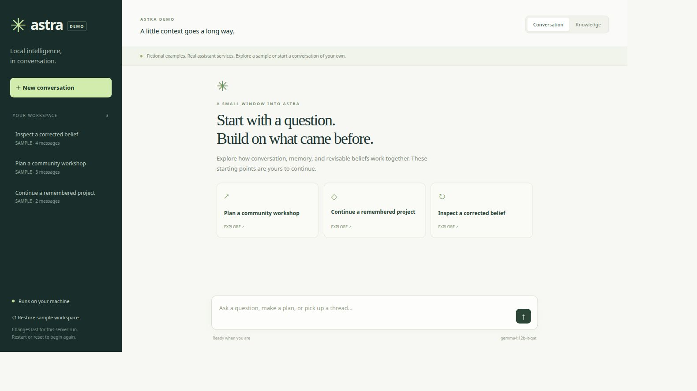

# Astra Demo

A local, disposable workspace for demonstrating conversation, memory, beliefs, English speech, screen context and shell tools.
The demo is an independent downstream project derived from Astra, with fictional
sample records and one standalone startup path.

Start the server with `.venv/bin/python main.py`, then open
[the demo](http://127.0.0.1:8001). Configuration defaults to the checked-in template;
a local `app/config/assistant.yaml` overrides it when present.

- [Architecture and state ownership](architecture.md)
- [Development and upstream updates](development.md)
- [Validation and current limits](validation.md)
- [Implementation planning record](implementation-plan.md)

