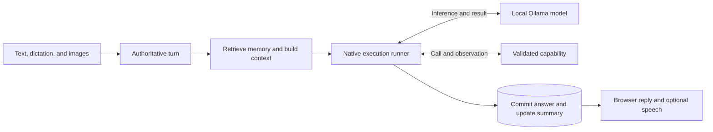

<section class="astra-hero" markdown>

# Astra Demo

Explore the local assistant runtime behind Astra with a fictional workspace you
can restore at any time. Continue a sample conversation, inspect what Astra
remembers, or connect your own tools.

[Get started](getting-started.md){ .md-button .md-button--primary }
[Explore the architecture](architecture.md){ .md-button }

</section>

## Four foundations

-   :material-account-circle-outline:{ .lg .middle } **Identity**

    ---

    The application attributes each turn to its participant and uses that
    identity to scope history access and tool actions.

-   :material-brain:{ .lg .middle } **Memory**

    ---

    Canonical history, rolling summaries, semantic facts, and episodic retrieval.

-   :material-thought-bubble-outline:{ .lg .middle } **Beliefs**

    ---

    Revisable claims preserve who said what. The sample workspace shows how a
    reported preference changes while the original conversation stays readable.

-   :material-robot-industrial-outline:{ .lg .middle } **Agency**

    ---

    The native execution runner validates tool arguments and bounds inference,
    tool dispatch, and optional reasoning continuation.

## What runs in the demo

Astra Demo uses the shared native execution runner, on-demand conversation
history, and optional web access and MCP. The browser supports English
dictation, speech playback, and per-message screen captures.

- [Project map](project-map.md) shows where each subsystem lives.
- [Service catalog](services/index.md) lists the local and optional dependencies.
- [MCP connections](services/mcp.md) explains server setup and tool review.
- [Validation](validation.md) records the demo checks and their limits.
