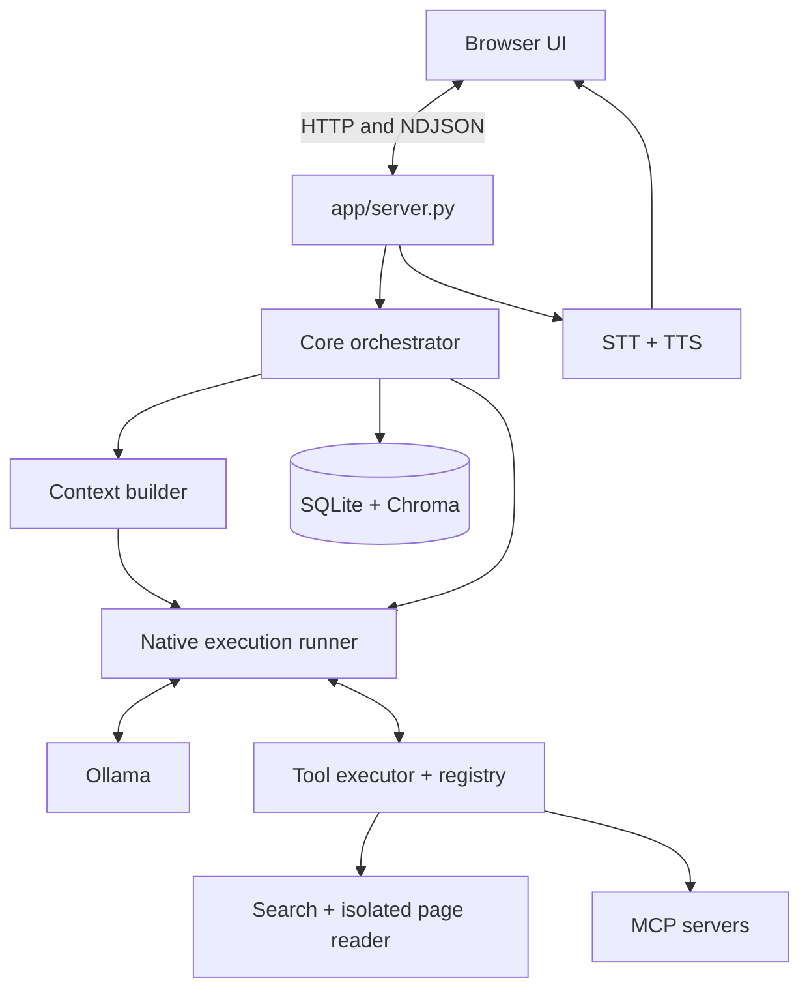

# Project map

Find a runtime component below or use [Where do I change...?](guides/where-to-change.md) to look up a specific task.

## Runtime at a glance

The browser and server own transport. The orchestrator owns the turn, and the
runner controls native inference and tool steps. Context construction and prompt
budgeting decide what the model sees. SQLite holds canonical records and Chroma
supports semantic retrieval.

## Source areas

| Area | Responsibility | Start here |
| --- | --- | --- |
| `app/server.py` | FastAPI routes, streamed turns, browser sessions, and static files | Message, session, attachment, and media routes |
| `app/demo/` | Workspace generations, fixtures, speech, and browser approvals | `runtime.py`, `seeds.py`, `speech.py`, `approvals.py` |
| `app/core/` | Turn lifecycle, context, native execution, and finalization | `orchestrator.py`, `context_builder.py`, `execution_loop.py`, `response_generator.py` |
| `app/llm/` | Ollama streaming and model-output normalization | `ollama_stream.py`, `thinking_filter.py` |
| `app/memory/` | Chat history, summaries, retrieval, and semantic memory | `chat_history.py`, `retriever.py`, `memory_store.py` |
| `app/storage/` | SQLite and vector-store infrastructure | `database.py`, `vector_store.py` |
| `app/perception/` | Image attachment contracts | `attachments.py`, `app/http/message_input.py` |
| `app/beliefs/` | Structured, revisable, provenance-aware beliefs | `service.py`, `repository.py`, `models.py` |
| `app/knowledge/` | Read-side knowledge views used by the UI | `service.py`, `models.py` |
| `app/integrations/` | Capability registration, invocation checks, history tools, and MCP | `registry.py`, `history.py`, `mcp.py`, `mcp_management.py` |
| `app/http/` | Feature-specific HTTP routes | `mcp.py`, `knowledge.py` |
| `app/tools/` | Shell, search, isolated page reading, and web provenance | `bash_execution.py`, `web_search.py`, `web/` |
| `main.py` | Standalone loopback launcher | `--port`, `--config` |
| `app/stt/`, `app/tts/` | Speech recognition and speech synthesis engines | Each folder's `factory.py` |
| `static/` | Browser application and styles | `index.html`, `main.js` |
| `tests/` | Python and browser-side regression tests | Find the test named after the subsystem |
| `docs/` | This generated documentation | `mkdocs.yml` controls navigation |

## Dependency direction

- `app/server.py` adapts HTTP requests to core and feature calls.
- `app/demo/` owns the workspace lifecycle and the browser approval adapter.
- `app/core/` coordinates a turn using feature contracts but does not own storage,
  model backends, transport, or external integrations.
- Feature packages (`memory`, `perception`, `beliefs`, and `knowledge`) own
  their domain-specific models and workflows.
- `app/integrations/` owns model-visible capability and event contracts; `app/tools/`
  owns concrete backend operations.
- `app/storage/`, `app/llm/`, `app/stt/`, and `app/tts/` isolate infrastructure and
  backend-specific behavior.

## Configuration map

The committed reference is `app/config/assistant-template.yaml`. Your machine-specific configuration is `app/config/assistant.yaml` and is intentionally ignored.

Configuration is validated at startup. Unknown keys, coercive scalar types, invalid
ranges, malformed identity values, and unsupported LLM endpoints fail with a field-level
error instead of being silently ignored.

| Configuration section | Controls |
| --- | --- |
| `llm` | Ollama endpoint, model, timeout, retries, generation settings |
| `execution`, `reasoning` | STANDARD/DEEP limits and opt-in task-local continuations |
| `context` | Recent history, retrieved memory, passive integration context, and prompt budgeting |
| `orchestrator` | Summary trigger and turn-level behavior |
| `beliefs` | Belief extraction mode, limits, expiry, and model budget |
| `autonomy` | Inherited native tool-step and approval timeout settings |
| `tts`, `stt` | Spoken input and output paths |
| `integrations` | Web discovery and reader, archive access, MCP servers, and other tool settings |
| `logging` | Runtime and trace log destinations and rotation |

## Runtime data

| Data | Storage | Authority |
| --- | --- | --- |
| Conversations, messages, summaries, attachment metadata | SQLite | Canonical |
| Semantic and episodic retrieval indexes | Chroma | Derived, searchable index |
| Uploaded and generated media | Managed paths under `.demo-state/` | File referenced by canonical metadata |
| Local behavior and endpoints | `app/config/assistant.yaml` | Machine-local configuration |
| Logs and traces | `.demo-state/logs/` | Diagnostic output |

## Current development shape

| Capability | State | Notes |
| --- | --- | --- |
| Text and multimodal turns | Active | Local Ollama-backed runtime |
| Conversation continuity | Active within a workspace | SQLite history, summaries, and semantic retrieval |
| Conversation archive tools | Implemented | Eligible direct chats and explicitly authorized archive sessions |
| Native execution runner | Implemented | Shared agent loop with bounded recovery and opt-in task-local reasoning |
| Web access | Implemented with optional reader | Structured search, isolated open/find, and retrieved-source footer |
| MCP client | Implemented, disabled by default | Explicit catalog management, selection, and approvals |
| Structured beliefs | Experimental | Observer and tool-react processing modes |
| Voice input and output | Active | Whisper and Kokoro defaults |

!!! tip "The shortest route"
    If you are about to search the whole repository, check [Where do I change...?](guides/where-to-change.md) first. It maps common intentions to configuration, implementation, tests, and supporting documentation.
