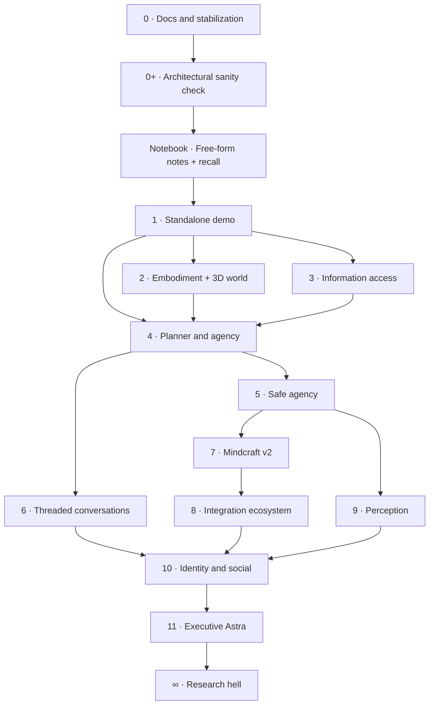
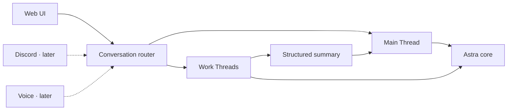

# Roadmap

This roadmap follows the main Astra project. The standalone demo showcases
selected milestones. [Getting started](getting-started.md#run-the-demo) covers
the demo today, and [Validation](validation.md) records what has been tested.

The roadmap is a dependency map, not a promise carved into an ancient GPU. Astra remains a hobby and research project: architectural coherence matters, but detours that are useful, surprising, or simply funny are legitimate development.

The standalone demo is complete. Astra now has bounded web and archive tools
(M3), a unified native execution backend (M4), and an optional MCP client (M8).
The [getting-started guide](https://github.com/danielmarek22/project-astra/blob/dev/docs/getting-started.md#run-astra) covers the local launcher
and its optional Mindcraft and documentation servers.

## 0 · Documentation and stabilization

COMPLETED

Make the system understandable and dependable before feeding it additional tentacles. This milestone establishes a reliable architectural reference and fixes the failures already visible in longer, multimodal conversations.

**The work**

- generate useful HTML documentation and keep its diagrams in source control;
- document subsystem boundaries, local services, and practical setup paths;
- restore previous conversations into bounded model context correctly;
- prevent old images and oversized history from silently exhausting a turn;
- improve timeout, retry, completion, and diagnostic behavior;
- clean up contradictions discovered while documenting the real system.

**Done when:** an interrupted or restored conversation behaves predictably, failures are visible rather than silent, and future-you can find the right subsystem without an archaeological expedition.

## 0+ · Architectural sanity check

COMPLETED

The [Milestone 0+ assessment](https://github.com/danielmarek22/project-astra/blob/dev/docs/milestone-0-plus.md) records what Astra should
own, reuse, refactor, or investigate against the stabilized baseline.

The three immediate repairs are implemented. The registry enforces capability
authority at dispatch, restored context uses summary checkpoints by message ID,
and the operation journal preserves the first terminal outcome. The
[framework comparison](https://github.com/danielmarek22/project-astra/blob/dev/docs/reviews/framework-comparison.md#1-findings-to-address-before-expansion)
records the original findings and regression coverage.

Future improvements are assigned to the milestones below. The [standalone improvement document](https://github.com/danielmarek22/project-astra/blob/dev/docs/reviews/future-improvements.md) retains detailed rationale, external references, and acceptance criteria. Astra keeps its custom orchestration and domain services; framework adoption remains conditional on a useful comparison.

## Before M1 · Notebook experiment

IMPLEMENTED · LIVE EVALUATION

The [persistent notebook](https://github.com/danielmarek22/project-astra/blob/dev/docs/architecture/scratchpad.md) gives Astra free-form notes with write/read/recent/search/edit/delete tools and automatic semantic recall on conversational turns. It coexists with memory and beliefs. Observe what Astra chooses to write and whether relevant notes return naturally across conversations before considering any cognitive-system consolidation.

**Validation:** deterministic storage, native-tool, context, and authority checks plus an isolated live recall experiment. Continued normal use evaluates relevance and spontaneous note-taking. Demo and future Relay deployments must keep notebook state isolated or disabled.

## 1 · Runtime profiles and demo mode

STANDALONE DEMO COMPLETE · RELAY DEFERRED

The demo was delivered as the separate downstream `astra-demo` project and is
complete per user confirmation. This supersedes the original in-process demo-profile
proposal. It does not establish that Personal, Demo, and Relay runtime profiles
were implemented in this repository. The profile-composition work below remains
a proposal; Relay is deferred.

**Architecture work · FI-01**

- compose Personal, Demo, and Relay profiles at startup through the existing factory and lifecycle boundaries;
- select prompts, stores, capabilities, and presentation explicitly, preserving shared tested services;
- verify state isolation and delegated authority with profile-level scenarios.

Reference: [FI-01 — Runtime profiles](https://github.com/danielmarek22/project-astra/blob/dev/docs/reviews/future-improvements.md#fi-01--explicit-runtime-profiles), borrowing typed dependency boundaries from Pydantic AI.

### Original demo-profile proposal (superseded)

**The work**

- provide a clean web-based, text-only interface without the VRM avatar;
- use a neutral system prompt and a fresh disposable database;
- exclude personal memories, beliefs, and private conversation history;
- expose a curated, low-risk tool set and safe sample tasks;
- make reset-to-clean-state immediate and reliable;
- optionally provide scripted showcase scenarios for research, planning, beliefs, and asynchronous work;
- exercise the real available belief, tool, and runtime services; add Planner showcase scenarios when M4 delivers them, without making M1 depend on a future Planner.

### Relay / frontend-only profile (deferred)

**The work**

- accept normalized messages and presentation cues from an external agent;
- render the external agent through Astra's existing chat, voice, expression, animation, and avatar frontend;
- keep Astra's local Planner, memory, beliefs, and tool execution disabled unless a capability is deliberately delegated;
- preserve the external source and conversation identity instead of recording relayed output as native Astra reasoning;
- define a small transport contract for text, streaming state, emotion, speech, interruption, and errors;
- make connection loss, cancellation, and reconnection visible and predictable;
- clearly indicate when the frontend is operating as a relay rather than the full local assistant.

**Original profile acceptance gate (not implemented):** the project can start in either a clean professional demo profile or a frontend-only relay profile, and neither mode can accidentally inherit Astra's private state or ambiguous ownership of an external agent's messages. The completed standalone demo does not claim this gate.

## 2 · Embodiment and 3D environment

Make Astra feel present before making her dramatically more capable. Voice, expression, motion, timing, and a persistent 3D space should behave as one embodiment system instead of several unrelated demos sharing a browser tab.

Speech synthesis has bounded per-fragment deadlines, and text completion can
arrive while audio is still queued. Browser playback and gesture handling have
regression coverage. See [speech delivery](https://github.com/danielmarek22/project-astra/blob/dev/docs/architecture/runtime.md#speech-delivery-deadlines).

**The work**

- smooth speech playback, interruption, and sentence timing;
- coordinate expressions, gestures, gaze, and speaking state;
- make outfit and avatar controls semantic through manifest-backed catalogs with stable IDs, validated asset references, and deliberate appearance persistence;
- give speech jobs, playback, and gestures explicit turn/utterance generation IDs; flush cancelled output and reject late media from superseded turns;
- separate media ownership from model capacity so optional speech does not retain the model slot once attribution is reliable;
- measure synthesis queue wait, first playable audio, playback start, and interruption-to-silence using the existing telemetry;
- consider process-isolated synthesis only if observed engine hangs justify a killable worker;
- create a loadable 3D environment with explicit scene, lighting, camera, and coordinate ownership;
- place and move Astra reliably within the environment rather than treating the avatar as a fixed overlay;
- add semantic environment locations and interactions such as standing, sitting, looking at, and moving toward scene anchors;
- keep environment assets replaceable without coupling cognitive code to mesh names or file paths;
- define loading, performance, and missing-asset fallbacks for the scene;
- improve loading, reconnecting, and silent-state feedback;
- keep embodiment optional so text-only operation remains healthy.

**Done when:** ordinary conversation feels coherent in voice and motion, interruption suppresses stale audio and gestures, and optional speech does not retain model capacity. Astra can inhabit a stable replaceable 3D scene, while text-only operation remains healthy.

References: [FI-02 — Media ownership](https://github.com/danielmarek22/project-astra/blob/dev/docs/reviews/future-improvements.md#fi-02--independent-media-ownership-and-interruption), the media portion of [FI-08](https://github.com/danielmarek22/project-astra/blob/dev/docs/reviews/future-improvements.md#fi-08--cancellation-and-resource-ownership), and [FI-12 — Measurements](https://github.com/danielmarek22/project-astra/blob/dev/docs/reviews/future-improvements.md#fi-12--measurements-and-evaluation-fixtures). Borrow Pipecat's lifecycle distinctions while retaining Astra's engines and renderer.

## 3 · Information access

IN PROGRESS · WEB AND ARCHIVE TOOLS AVAILABLE

**Implemented**

- `web__search` returns bounded source records. SearXNG is the default discovery
  provider. LangSearch is available as an explicitly configured hosted option.
- `web__open` and `web__find` use an opt-in isolated Crawl4AI reader with
  conversation-owned snapshots and bounded excerpts. Web-assisted replies can
  include a saved **Sources retrieved** footer.
- `history__search` and `history__read` retrieve bounded excerpts from saved
  conversations. Access to other conversations requires explicit configuration
  and an eligible local-owner turn. See [conversation history](architecture/memory.md#on-demand-conversation-history).
- The [prompt guard](architecture/context-building.md#per-request-prompt-budget)
  reserves completion space and compacts web and MCP evidence when enabled.
  Native continuations preserve the selected call and its matching result.
- The [launcher](https://github.com/danielmarek22/project-astra/blob/dev/docs/getting-started.md#start-docker-desktop-and-searxng-with-astra)
  checks the existing local SearXNG stack before starting Astra.

**Remaining work**

- Evaluate source traceability, evidence retention, provider failures, and
  latency across realistic local-model runs and restored UI sessions. Focused
  live open/find and two-source checks passed. Natural requests can still
  produce unsupported answers, and search depends on upstream engine availability.
- Give larger results bounded artifact readers and preserve freshness and
  provenance when live evidence appears alongside remembered claims.
- Add focused local-file and project-knowledge readers.
- Add browser interaction and screenshot capabilities with explicit authority,
  bounded artifacts, and M5 execution controls.

See the [web-access notes](https://github.com/danielmarek22/project-astra/blob/dev/docs/architecture/web-access.md) for the implementation,
historical test evidence, and remaining evaluation cases.

**Done when:** Astra can inspect page content and answer with traceable sources, report retrieval failures, and handle oversized inputs/results predictably within a prompt budget that reserves completion space.

References: [FI-03 — Search and reading](https://github.com/danielmarek22/project-astra/blob/dev/docs/reviews/future-improvements.md#fi-03--structured-search-results-and-explicit-page-reading), [FI-04 — Budgets](https://github.com/danielmarek22/project-astra/blob/dev/docs/reviews/future-improvements.md#fi-04--prompt-and-tool-output-budgets), and [FI-12 — Evaluation](https://github.com/danielmarek22/project-astra/blob/dev/docs/reviews/future-improvements.md#fi-12--measurements-and-evaluation-fixtures). Reuse extraction components and borrow explicit budget patterns from Letta Code and Pydantic AI.

## 4 · Planner and agency

IN PROGRESS · NATIVE EXECUTION BACKEND IMPLEMENTED

**Implemented**

- One [native execution state machine](architecture/runtime.md#native-execution-state-machine)
  runs chat agent turns and autonomous integration turns. It coordinates typed
  inference outcomes, one selected tool call per step, and bounded recovery.
- Buffered inference exposes the finish reason and available usage counters.
  Truncated generations enter tool-free recovery before dispatch or final rendering.
- STANDARD and DEEP share the runner and can override limits independently.
  Inference attempts, external dispatches, and internal continuations have
  separate accounting.
- The opt-in `reasoning__continue` capability maintains a bounded in-memory
  workspace for the current run. Model evaluation is still needed before
  enabling it by default.

**Remaining work**

- Persist task objectives, step and attempt identity, action/result references,
  approval bindings, remaining budget, and recovery rules.
- Support durable approval waits and restart/resume, revalidating exact arguments
  and authority on resumption.
- Separate session mutation ownership, model capacity, external waits, and
  media delivery. Add cooperative cancellation and reject stale callbacks.
- Reconcile uncertain side effects by stable operation identity. Track
  task-wide deadlines, aggregate usage, step outcomes, and queue wait.
- Exercise partial successes, blocked tasks, cancellation, and recovery on
  representative tasks.

**Decision gate for durable execution** — compare extending the existing runner
with a minimal LangGraph prototype using the same tool, approval wait, restart,
resume, cancellation, and late-completion scenario. Preserve Astra's authority
and storage contracts and keep one scheduling owner.

**Done when:** a multi-step task has an explicit outcome, survives supported waits/restarts with its authority and budget intact, and handles cancellation and uncertain side effects without inventing success or duplicating actions. M5 extends these contracts to stronger execution isolation and policy enforcement.

References: [FI-05 — Typed steps](https://github.com/danielmarek22/project-astra/blob/dev/docs/reviews/future-improvements.md#fi-05--typed-execution-steps-observations-and-outcomes), [FI-06 — Tool policy](https://github.com/danielmarek22/project-astra/blob/dev/docs/reviews/future-improvements.md#fi-06--consistent-tool-execution-policy), [FI-07 — Durable tasks](https://github.com/danielmarek22/project-astra/blob/dev/docs/reviews/future-improvements.md#fi-07--durable-tasks-and-approval-waits), [FI-08 — Cancellation](https://github.com/danielmarek22/project-astra/blob/dev/docs/reviews/future-improvements.md#fi-08--cancellation-and-resource-ownership), and [FI-12 — Evaluation](https://github.com/danielmarek22/project-astra/blob/dev/docs/reviews/future-improvements.md#fi-12--measurements-and-evaluation-fixtures). Borrow patterns from smolagents, Pydantic AI, OpenHands, and LangGraph.

## 5 · Safe agency

Capability without boundaries is merely an exciting incident report. This milestone makes consequential actions explicit, reviewable, and limited by application-owned policy.

**The work**

- classify actions by risk and required approval;
- add clear confirmation and cancellation flows;
- enforce time, step, concurrency, and resource budgets;
- keep an audit trail of requests, approvals, actions, and results;
- isolate risky tools and default to the least authority required;
- introduce an execution backend boundary with explicit workspace access, credentials, owned subprocesses, bounded output, artifacts, and cleanup;
- reuse an appropriate container/sandbox implementation, validating the selected backend rather than treating approval as isolation;
- bind approvals to exact actions and enforce consistent policy across user, event, and headless entry paths;
- distinguish requested cancellation from confirmed stopping; stop owned process trees where supported and quarantine uncertain late results;
- verify timeout, duplicate-result, cancellation, and containment behavior with deterministic fixtures.

**Done when:** the model cannot grant itself permission, approved work stays within its configured execution boundary, confirmed stops remain terminal, and artifacts and results can be traced to their authorized action.

References: the enforcement portion of [FI-06](https://github.com/danielmarek22/project-astra/blob/dev/docs/reviews/future-improvements.md#fi-06--consistent-tool-execution-policy), [FI-08 — Cancellation](https://github.com/danielmarek22/project-astra/blob/dev/docs/reviews/future-improvements.md#fi-08--cancellation-and-resource-ownership), and [FI-09 — Execution isolation](https://github.com/danielmarek22/project-astra/blob/dev/docs/reviews/future-improvements.md#fi-09--isolated-execution-environments). Borrow OpenHands' execution boundary and evaluate existing isolation components; no particular backend is preselected.

## 6 · Threaded conversation architecture

Replace a collection of isolated, OpenAI-style chat sessions with one canonical conversational continuity and optional work threads. Detailed task work gets room to breathe without flooding Astra's primary history forever.

**There is one Astra and one primary conversational continuity. Work threads are scoped attention contexts, not separate instances of Astra.**

**The work**

- introduce a conversation model with one long-lived Main Thread;
- add work threads with explicit objectives and `ACTIVE`, `PAUSED`, `COMPLETED`, and `ARCHIVED` states;
- associate Planner tasks, artifacts, decisions, and unresolved items with their work thread;
- return structured checkpoints containing objective, outcome, decisions, artifacts, and unresolved items to the Main Thread instead of copying full transcripts;
- preserve thread, task, message, and participant provenance in memories and beliefs;
- keep work-thread belief extraction conservative until durable knowledge is deliberately promoted;
- preserve canonical storage, explicit memory budgets, and source visibility through promotion; evaluate retrieval quality before introducing decay or reinforcement;
- keep execution-run IDs separate from the Main/Work Thread product model;
- route normalized messages through a transport-neutral conversation layer;
- adapt the web UI first, leaving clean connection points for Discord, voice, CLI, and future interfaces.

**Done when:** Astra has one unmistakable primary continuity, a substantial task runs in a scoped thread, and its outcome returns as compact state with provenance and visibility intact. Minecraft coordinates and debugging detail remain local unless deliberately promoted.

Reference: [FI-11 — Scoped continuity](https://github.com/danielmarek22/project-astra/blob/dev/docs/reviews/future-improvements.md#fi-11--scoped-continuity-and-deliberate-memory-policy). Learn from Letta's persistent-memory design while retaining Astra's thread and belief semantics.

## 7 · Mindcraft v2

Turn the Minecraft experiment into a first-class embodied integration rather than a particularly elaborate remote-control trick. The world becomes a test environment for planning, feedback, interruption, and consequences.

**The work**

- mature the typed protocol in the project-specific Mindcraft fork;
- expand observable world state and structured action results;
- support longer goals through small, cancellable operations;
- improve capture, navigation, recovery, and event handling;
- keep `external` and `hybrid` controller ownership unambiguous.

**Done when:** Astra can pursue a modest in-world goal, report meaningful progress, recover from ordinary failures, and stop immediately when asked.

## 8 · Integration ecosystem

IN PROGRESS · MCP CLIENT IMPLEMENTED

The [MCP client](services/mcp.md) connects stdio or Streamable HTTP servers to
Astra's capability registry. The MCP tab manages connections, catalog refreshes,
reviewed tool definitions, and per-tool approvals. MCP execution uses Astra's
existing authority and result limits. Compatibility checks covered the MCP
Everything fixture and the Gmail catalog. A live Gmail read succeeded in a
follow-up turn. Recovery after dispatch exhaustion can still omit earlier
observations.

**Remaining work**

- Use the common adapter contracts for more services and games. Validate
  lifecycle, approval, timeout, cancellation, and reconnect scenarios.
- Verify separately scoped provider authorization before adding a read-only
  Gmail account. Astra tool choices and provider grants are separate controls.
- Investigate A2A for a concrete compatible external agent, preserving task
  ownership and attribution of remote claims.
- Evaluate reusable game adapters, including published Neuro integrations.
- Document which environment context is transient and which information may
  become durable memory or belief.

**Done when:** a real game or service can be connected through a documented adapter boundary, reuse an existing implementation where appropriate, and pass lifecycle and approval scenarios without leaking environment-specific machinery into Astra's core.

Reference: [FI-10 — External connections](https://github.com/danielmarek22/project-astra/blob/dev/docs/reviews/future-improvements.md#fi-10--standard-external-tool-connections). MCP and A2A are distinct integration options; neither replaces application-owned permissions or establishes the truth of external claims.

## 9 · Perception

Let Astra notice useful changes without continuously throwing expensive vision models at the universe. Perception should create compact, timestamped state that downstream systems can reason about.

**The work**

- unify screen, camera, audio, and integration observations;
- run cheap change detection before expensive interpretation;
- distinguish live state from historical summaries;
- attach source, confidence, and freshness to observations;
- make demand-driven inspection available to plans and tools.

**Done when:** Astra can notice a relevant change, explain what signal it came from, and ignore an unchanged room without melting the GPU.

## 10 · Identity and social

Make identity a formal part of the system. Astra should understand who is speaking, which conversation owns which context, and where personal memories or beliefs may safely appear.

**The work**

- formalize assistant, local-human, participant, and sender identities using stable IDs and explicit transport mappings;
- allow display-name changes without creating a new participant or rewriting historical attribution;
- strengthen session ownership and group-conversation boundaries;
- apply visibility rules to memories and beliefs;
- preserve disagreement and attribution instead of inventing consensus;
- develop a stable persona without burying authority in prompt prose.

**Done when:** Astra can participate in a multi-person conversation without mixing up speakers, leaking private context, or erasing disagreement. Participant renaming and knowledge promotion preserve stable identity, attribution, and visibility.

Reference: the identity portion of [FI-11](https://github.com/danielmarek22/project-astra/blob/dev/docs/reviews/future-improvements.md#fi-11--scoped-continuity-and-deliberate-memory-policy); identity and belief policy remain Astra-owned.

## 11 · Executive Astra

Give Astra a useful long horizon: projects, commitments, follow-ups, and gentle initiative. “Executive” means helping the user keep direction—not acquiring a tiny suit and scheduling a board meeting, although neither is ruled out.

**The work**

- represent projects, goals, next actions, waiting items, and review dates;
- connect conversations to durable commitments without saving every remark;
- produce concise briefings and surface genuinely relevant follow-ups;
- coordinate reminders and external services behind explicit consent;
- preserve a clear distinction between a suggestion and an authorized action.

**Done when:** Astra can help maintain a real project over time, surface the right unfinished thread, and remain quiet when there is nothing useful to add.

## ∞ · Research hell

The respectable milestones end here. Beyond this point are experiments that may become architecture, remain delightful side quests, or teach one valuable lesson immediately before catching fire.

Possible residents include simulated worlds, multi-agent social behavior, richer emotion models, skill learning, local fine-tuning, spatial memory, robotics, self-evaluation, and ideas currently described only as “okay, hear me out.”

**There is no done when.** Research hell is successful when experiments stay isolated enough to be fun, observable enough to teach something, and honest enough not to masquerade as finished infrastructure.

## Evaluation across milestones · FI-12

Extend the existing telemetry rather than creating a parallel recorder. Each milestone should add relevant deterministic failure fixtures and representative local-model scenarios: profile isolation in M1, media interruption in M2, source quality and bounds in M3, and restart/approval/cancellation in M4–5. Later integrations should reuse these contracts and measurements.

Compare correctness alongside queue wait, first visible text, first playable audio, interruption latency, model calls/tokens, and resource use where relevant. A framework or dependency should earn adoption against the same baseline scenarios. See [FI-12 — Measurements and evaluation](https://github.com/danielmarek22/project-astra/blob/dev/docs/reviews/future-improvements.md#fi-12--measurements-and-evaluation-fixtures).

## Guiding principles

- Extend before rewriting; retain custom orchestration and domain semantics.
- Reuse bounded components, borrow useful patterns, and compare frameworks before adopting them.
- Implement future improvements in their owning milestone, bringing forward only prerequisites required by active work.
- Prefer semantic interfaces over asset-specific interfaces.
- Make expensive intelligence demand-driven.
- Preserve room for experiments that make Astra useful, surprising, or fun.
